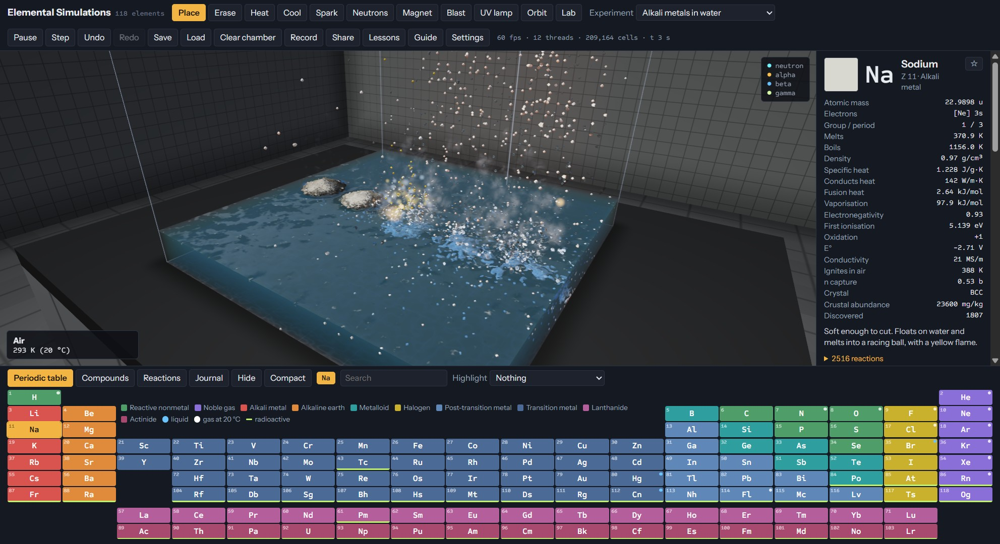
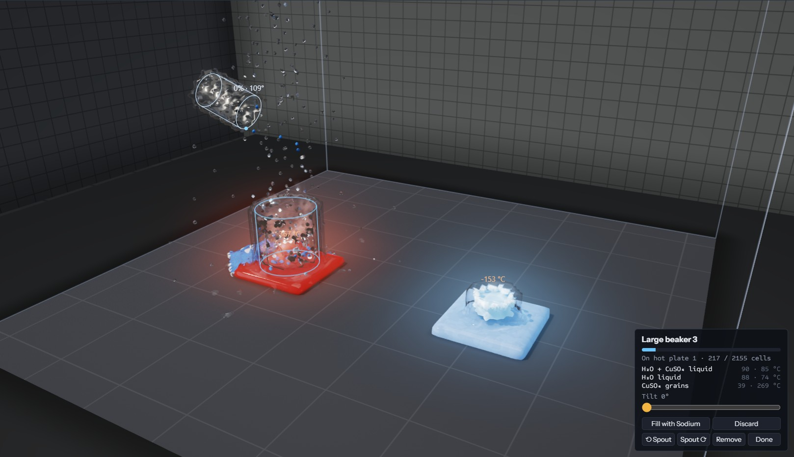
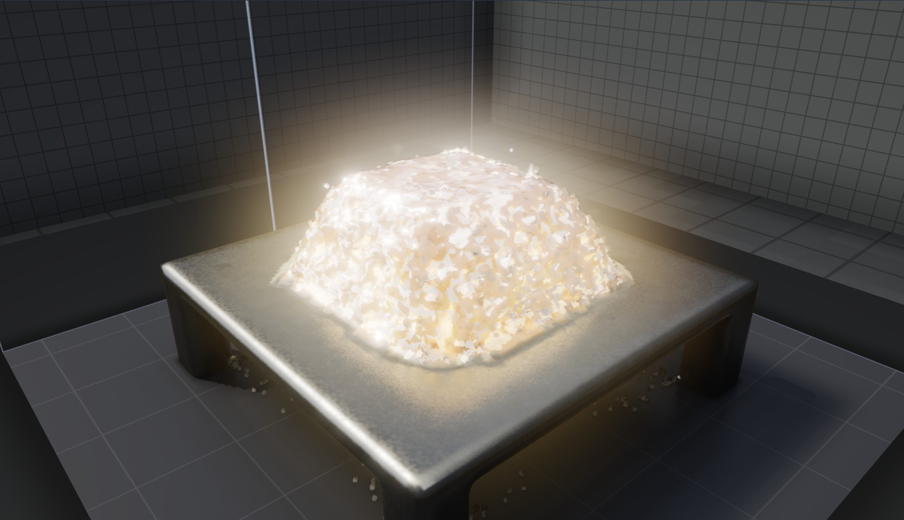
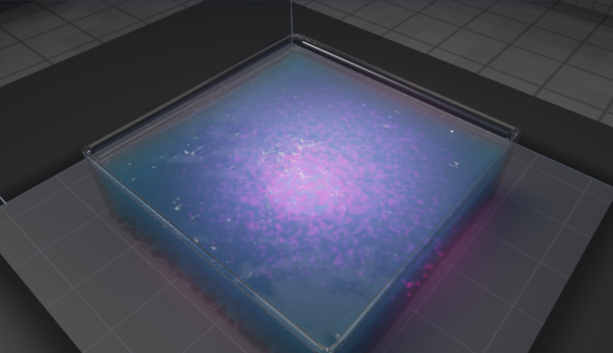
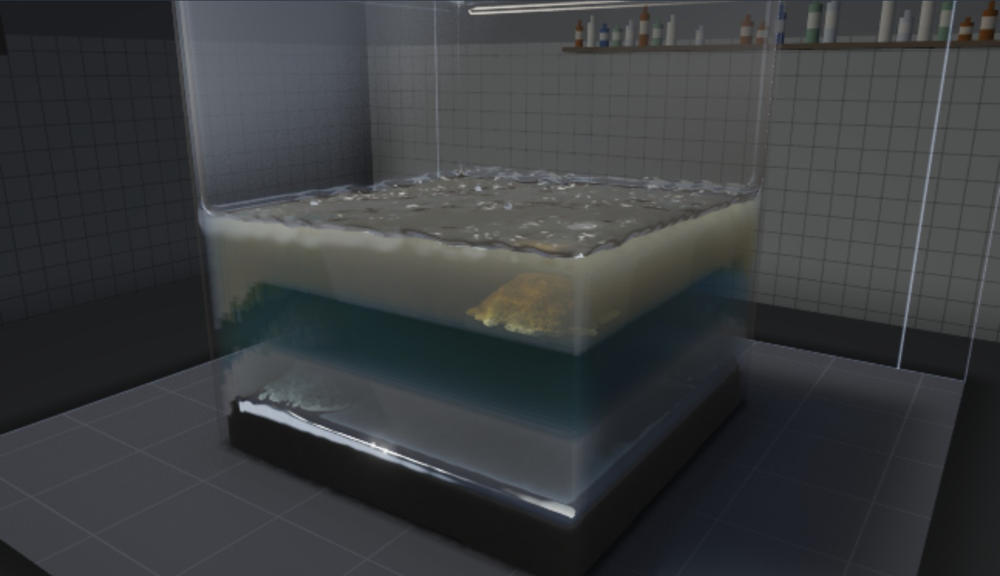
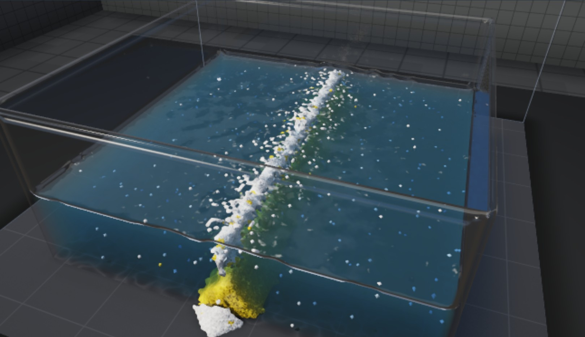

# Elemental Simulations

**A chemistry sandbox where every one of the 118 elements behaves according to its real properties.** Pour, heat, mix, spark and irradiate materials in a 3D chamber and watch reactions emerge from measured data: melting and boiling points, densities, heats of formation, electrode potentials, half-lives and more.



*The opening experiment. The five alkali metals fall into water and react harder the further down the group they are. Rubidium and caesium catch fire before they even land.*

> **Status:** in active development, heading for a desktop release on Steam. See [ROADMAP.md](ROADMAP.md) for the plan and what is done.

## Contents

- [Highlights](#highlights)
- [Gallery](#gallery)
- [Getting started](#getting-started)
- [How to play](#how-to-play)
- [Lab equipment](#lab-equipment)
- [The experiments](#the-experiments)
- [Saving and settings](#saving-and-settings)
- [The science](#the-science)
- [How it is built](#how-it-is-built)
- [Development](#development)

## Highlights

- **All 118 elements and 3,150 materials.** Salts get their formulas from real oxidation states across 28 anions. 223 molecules, organics and alloys are entered by hand from reference values.
- **Chemistry in true moles.** 548 balanced equations in 13 groups, plus generated rules for every metal: acids, bases, decomposition, precipitation and displacement. Gibbs energy decides which way a reaction goes, and Arrhenius rates decide how fast.
- **Physics that matters for chemistry.** Heat flow with latent-heat plateaus, convection, evaporation, pressure, air currents, load-bearing solids that collapse, electricity, galvanic cells, magnetism, 726 radioactive isotopes, neutron transport, fission and fusion.
- **A lab to work in.** Beakers, test tubes, a crucible, an evaporating dish, reagent bottles, hot plates, stirrers, chillers, gas burners, a balance, stoppers, thermometers, droppers, funnels, gas syringes, tongs, a spark igniter, a Geiger counter, a bell jar, a condenser and a power supply that you carry, tip, pour, filter, seal, weigh, heat, cool, stir, measure, ignite, distil, pump out, collect gas and electrolyse with. Equipment becomes part of the simulation, so whatever is inside reacts and boils like anything else.
- **Honest about itself.** Estimated values are marked as estimated. Every experiment's description is checked by an automated test, and the [simplifications](#what-is-simplified) are listed below.
- **Uses the whole machine.** The simulation runs across every CPU core, and a WebGL2 raymarcher draws it with soft shadows, refraction, caustics and bloom.

## Gallery

| | |
| --- | --- |
|  |  |
| **Lab equipment.** A large beaker boils on a 370 °C hot plate, water freezes in a crucible on a −153 °C chiller, and a carried jug pours copper sulfate. The panel lists what the selected beaker holds. | **Thermite.** Aluminium and rust sit still until a hot spot reaches about 1100 K. Then the reaction front spreads by itself, and molten iron sinks through the slag. |
|  |  |
| **Acid-base titration.** Sodium hydroxide goes into acid holding phenolphthalein. Once the acid is used up, the base turns the water pink. | **Density column.** Mercury, carbon tetrachloride, water and octane settle by density. Iron and aluminium float on the mercury, gold sinks in and dissolves, and ice stops where the water meets the octane. |
|  | |
| **Golden rain.** Lead nitrate and potassium iodide solutions meet in the middle and throw down yellow lead iodide. | |

The thermite, titration, density column and golden rain pictures were taken before those experiments moved onto lab equipment (a crucible, a beaker on a stirrer with a dropper, a tall beaker and a large beaker), and need retaking with `npm run screenshots`.

All the pictures are taken by the game itself with `npm run screenshots`, so they can be retaken after any change. See [Development](#development).

## Getting started

### Desktop app (recommended)

Needs [Node.js](https://nodejs.org/) 18 or later. From the project folder:

```bash
npm install
```

```bash
npm start
```

The desktop app uses every CPU core with no extra setup. `F11` or **Settings** switches to full screen, and the window remembers its size. To build a Windows copy you can share, run `npm run package:win`, and the build lands in `dist/`.

### In a browser

Double-click **Start Elemental.bat**. It starts a small local server with Python and opens the game in your browser with every core in use. Python needs to be on your PATH.

Opening `index.html` directly works too, but browsers only allow the shared memory the engine needs from a server that sends the right headers. Opened as a file, the game runs on one core with a smaller chamber.

### What it needs

- A graphics card with WebGL2. Any GPU from the last decade will do, with hardware acceleration turned on.
- The more CPU cores, the bigger and faster the chamber. On machines with 8 or more cores it starts at 128 × 80 × 128 cells, and you can go up to 224 × 128 × 224 in the Chamber menu.

## How to play

Pick an element from the periodic table or a compound from the Compounds tab, then draw into the chamber. Every cell carries a real temperature in kelvin, and what happens next follows from each material's measured properties. Not sure where to start? Choose an **Experiment** from the menu, or open **Lessons** for six guided walk-throughs: heating curves, flame colours, limiting reagents, acids and pH, batteries, and chain reactions.

### Tools

| Key | Tool | What it does |
| --- | --- | --- |
| `1` | Place | Pour the selected material. **Height** sets how far above the surface, **Place at** its starting temperature. |
| `2` | Erase | Remove material. |
| `3` | Heat | Raise the temperature under the brush. |
| `4` | Cool | Lower it, all the way towards absolute zero. |
| `5` | Spark | Send current through conductors, electrolytes and gases. |
| `6` | Neutrons | Fire a neutron source, to start fission or breed isotopes. |
| `7` | Magnet | Pull ferromagnets that are below their Curie point. |
| `8` | Blast | Set off a blast wave. |
| `9` | UV lamp | Shine ultraviolet light to drive photochemistry. |
| | Orbit | Drag to turn the view, handy on touch screens. |
| `B` | Lab | Containers, reagent bottles, hot plates, stirrers, chillers, gas burners and hand tools. See [Lab equipment](#lab-equipment). |

### Camera and keys

| Input | Action |
| --- | --- |
| Left drag | Use the current tool |
| Right drag | Orbit the view |
| Middle drag, or `Shift` + right drag | Pan |
| Wheel | Zoom |
| Arrow keys, `+` and `−` | Turn, tilt and zoom. `Home` resets the view. |
| Middle double-click, or `Alt` + double-click | Centre the view on what is under the pointer |
| `[` and `]` | Brush size |
| `Space` | Pause |
| `P` | Pin the cell under the pointer and graph its temperature |
| `H` | Heat view, which colours everything by temperature |
| `L` | Switch between the realistic look and the original voxel look |
| `T` | Hide the periodic table |
| `*` | Add the selected material to your favourites |
| `Ctrl` + `Z` and `Ctrl` + `Y` | Undo and redo |

### Finding materials

- **Periodic table:** the **Highlight** menu picks out liquids, gases, radioactive elements, fissile ones, ferromagnets, superconductors, neutron absorbers, and elements that react with water.
- **Compounds:** narrow the list to acids, bases, salts, oxides, organics, alloys, gases or liquids, or search it by name or formula.
- **Reactions:** search every equation in the database. Click one to watch it run in a small test rig.
- **Journal:** keeps every reaction you have seen.
- **Favourites:** star a material on its data card, or press `*`. Favourites stay at the front of the bar under the chamber between sessions.

The data card shows each material's properties, with estimated values marked, and lists every reaction it can take part in.

## Lab equipment

Press `B` or choose **Lab**, pick something in the panel, then click a surface to set it down. The equipment is modelled in Blender and drawn as smooth meshes over the chamber, while what it holds stays real material.

| Equipment | Notes |
| --- | --- |
| Beaker, test tube, large beaker, crucible | Fill with `F` or the panel. Drag to carry. The wheel tips a carried container so it pours, and `Shift` + wheel lifts it. `Q` and `E` turn the spout. |
| Evaporating dish | Wide and shallow, for boiling a solution down until its salt is left. |
| Reagent bottle | Pick a reagent in the panel first: acids and alkalis at 1 M, salt solutions, indicators, ethanol. Each bottle comes full and labelled, and its solution keeps its strength wherever you pour it. |
| Hot plate | Up to 600 °C from the panel. Heats whatever stands on it, including a container's contents. |
| Stirrer | A hot plate that also stirs, slow, medium or fast. Grains swirl up into the liquid, so they dissolve and react faster. |
| Chiller | Down to −196 °C, the temperature of liquid nitrogen. Freezes what stands on it. |
| Gas burner | Keeps a flame burning above its nozzle until you turn it off. Put a metal salt around the nozzle and the flame takes the metal's colour. |
| Stopper | **Stopper** in a container's panel seals it. A stoppered container does not spill, and gas builds up inside until the stopper pops out: bring sealed water to the boil and watch. |
| Thermometer | Click a container to drop one in. It sinks to the bottom and shows the temperature above it, with pH and pressure in the panel. |
| Dropper | **Draw up** takes up to 20 drops of liquid at its tip. Carry it over a container and add **1 drop** at a time, or **Squeeze out** the lot. |
| Funnel | Click a container to set one in its mouth, then pour a mixture in. With filter paper in, liquid runs through and solids stay behind. |
| Gas syringe | Click a container to connect one: it stoppers the container and collects the gas it gives off, up to 100 cells, until you push it out. |
| Balance | Weighs what stands on it, in grams. **Tare** zeroes it with an empty container on it. |
| Tongs | Grip a small piece of a solid, carry it into a burner's flame and let go: the tongs stay in their clamp and hold it there. |
| Spark igniter | Sparks at its tip. Hold it where hydrogen meets the air and it pops. |
| Geiger counter | Clicks and counts the radiation passing its window, in counts a second. |
| Bell jar | Put it over something and pump the air out. Water boils at room temperature and chills itself, and nothing can burn inside. |
| Condenser | Click a flask to connect one. Heat the flask and what boils off drips from the outlet as liquid, leaving anything dissolved behind: boil brine and collect pure water. |
| Power supply | Two electrode rods on a clamp. Drop them into water or a salt solution, switch on and set 1.23 to 12 V: the current splits water into hydrogen and oxygen and plates metals out of their salts. |

Carried containers scoop up liquid or powder they are dipped into and catch a poured stream, and they rise over solid obstacles instead of passing through them. When a container sits still, it becomes real glass cells in the chamber, and from then on its contents conduct heat, boil and react like anything else. Lift it again and everything inside comes with it. Nothing is created or lost in these exchanges, and the tests check that.

## The experiments

The **Experiment** menu has 22 ready-made set-ups, built from the same lab equipment you can use yourself wherever a real bench would have it. Each one opens with a note on what to look for, and an automated test checks that the experiment really does it.

| Experiment | What happens |
| --- | --- |
| Alkali metals in water | Li, Na, K, Rb and Cs, each dropped into its own beaker of water, react faster the further down the group they are. Rb and Cs catch fire in the air before they land. |
| Thermite in a crucible | Nothing happens until about 1100 K, then a self-sustaining front leaves molten iron under the slag. |
| Reactor in a water pool | Cadmium-sleeved fuel rods hold the chain reaction back. Withdraw the control rods and fission climbs until the pool boils. |
| Decay chains | Oganesson, plutonium, radium and polonium decay in four crucibles at their own pace down to lead, with a Geiger counter over the polonium. The heaviest nuclei also fission. |
| Noble gas discharge tubes | Helium, neon, argon, krypton and xenon glow in their own colours, each in a sealed glass tube. |
| Flame tests | Eight gas burners, each with a metal salt around its nozzle, burn in the real flame-test colours for as long as the gas is on. |
| Density column | Four liquids stack by density in a tall beaker, and solids find their level. |
| Acids and the activity series | In three beakers of hydrochloric acid zinc fizzes fastest and copper not at all. In a fourth, aqua regia dissolves gold. |
| Golden rain | Clear solutions meet in a large beaker and throw down yellow lead iodide. |
| Lamp filament and electrolysis | The same current makes tungsten glow while copper stays cooler. Tungsten burns through in air, which is why lamps are filled with argon. A power supply's rods split water in a beaker. |
| The uranium-238 decay chain | A dish of U-238 walks the real chain through thorium, radium and radon down to lead-206, under a Geiger counter. |
| Breeding plutonium | Neutrons from an enriched core turn a U-238 blanket into neptunium and then plutonium-239. |
| Daniell cell | Zinc and copper half-cells give 1.10 V. Zinc dissolves and copper plates out as the cell runs down. |
| Acid-base titration | A dropper lets sodium hydroxide into acid on a magnetic stirrer. Once the acid is used up, the drops stay pink. |
| Melting supports | Lead pillars on a hot plate soften and the steel deck falls in one piece. |
| Dichromate volcano | Ammonium dichromate in an evaporating dish decomposes into a heap of green chromium oxide. |
| Hydrogen peroxide and catalyst | Manganese dioxide dropped into a beaker of peroxide releases a rush of oxygen without being used up. |
| Sugar and sulfuric acid | Acid poured on sugar in a beaker strips the water out of it and leaves black carbon. |
| Black powder | Saltpetre, sulfur and charcoal in a dish hold still until 600 K, then burn through. |
| Contact explosive | Nitrogen triiodide on a warm hot plate goes off in a cloud of violet iodine. |
| Colour tests | Droppers let reagent into four beakers of bench-strength solution: copper ammine blue, iron thiocyanate red, and lead and silver chromates. |
| Cryogenic bench | Liquid nitrogen boils off in a large beaker, liquid oxygen is pale blue, and gallium melts in a crucible on a hot plate. |

## Saving and settings

- **Save** and **Load** write and read `.elemental` files. A file holds every cell, your lab equipment, the room settings and the camera. Files are checked thoroughly before anything changes, so a damaged or foreign file only gives a message.
- **Undo** remembers the last six changes, including changes to the chamber size and to equipment.
- **Automatic save** keeps a copy of your chamber about once a minute. Next time you start, the game offers to continue where you left off. If the graphics driver resets, the game saves, reloads and carries on by itself.
- **Settings:** full screen, render quality (automatic, high, medium or low), realistic or voxel look, the laboratory surroundings, reaction effects, interface size, chamber size at launch, and the automatic save. Reaction effects start off for players whose system asks for reduced motion.

## The science

### Where the data comes from

- **Elements:** generated by `tools/gen_elements.py`, which merges the [Mendeleev](https://github.com/lmmentel/mendeleev) database with [PubChem's periodic table](https://pubchem.ncbi.nlm.nih.gov/periodic-table/), corrects known errors and fills gaps. Predicted or rule-of-thumb values are marked `est`, and the game labels them as estimated. On top of that, `js/elements.js` adds real colours, flame-test colours, electrode potentials, ignition points, electrical conductivity, superconducting and Curie temperatures, neutron cross-sections and a note for each element.
- **Compounds:** `js/species.js` holds named molecules, salts, organics and alloys, with melting and boiling points, density and heat of formation from standard reference values. `tools/verify_species.py` checks them against PubChem.
- **Isotopes:** `tools/gen_isotopes.py` generates half-lives and decay modes for 726 isotopes.
- **Reactions:** `js/reactions.js` holds the balanced equations, with temperature windows, catalysts, current, UV light and rates. `js/chem.js` balances generated equations itself. Reaction heat comes from heats of formation wherever they are all known.

### What is real

Melting and boiling points, density by phase, specific heat, thermal conductivity, latent heats, electronegativity, ionisation energy, oxidation states, electrode potentials, electrical conductivity, Curie points, superconducting temperatures, neutron cross-sections, half-lives and decay modes. Cells hold true amounts in moles. Gas density follows the ideal gas law, so hot gas rises and xenon sinks. Heating curves plateau at phase changes because latent heat is banked. Water reports its pH, with buffers and solubility products. [VALIDATION.md](VALIDATION.md) compares 53 results with measured values.

### What is simplified

A voxel game has to bend some of the physics to fit on a computer and on a screen. These are the main places it does.

- Dissolved salts are tracked as salts behaving as their ions, not as separate ions. Each water cell holds at most two dissolved species. An indicator such as phenolphthalein takes one of the two, but always lets an acid or base in, and a bystander salt moves along to make room, so the colour can follow the pH.
- Gases hold the moles of a cell at condensed density, far denser than a real gas, so a few cells of gas can react with a few cells of solid.
- Activation energies are derived from onset temperatures, not measured. Entropies and enthalpies are 298 K values, with steam the one correction.
- Half-lives are log-compressed so the whole range can be watched. Their order is preserved.
- Thermal diffusivity is square-root compressed, and latent heats run at half value. Gas conductivity follows molar mass, not a measured value for each gas. Conductivity does not change with temperature. Loose grains and joins between different solids use one fixed factor each.
- Viscosity is compressed logarithmically and follows Andrade's law with temperature. About 50 liquids use measured values. The rest come from rules: Andrade's melting-point formula for metals, a typical value for ionic melts, and Eyring's rule for molecules. These are estimates. Nothing thickens or thins under shear.
- Density follows temperature in liquids and grains, and dissolved salt in water, but voxels do not change size, so thermal expansion cannot strain or crack anything.
- Surface tension keeps liquids in one connected body and beads molten metal two cells deep. A voxel is larger than the capillary length, so there is no meniscus, and grains have no pore space, so nothing wicks.
- Evaporation is compressed to a matter of minutes. Each air cell holds one vapour, on the same condensed scale as gas cells, so saturation in air uses partial pressures from Clausius-Clapeyron but the amounts are far larger than real ones. Latent heat leaving a liquid is counted. Heat released to the air when vapour condenses is not.
- Radiation travels along the six axes and up to 14 cells, to keep threads safe. Past that it is lost. Gases are treated as transparent. Emissivity is one value per class of material.
- Nucleation uses fixed thresholds: 15% of the melting point on its own, 2% on a foreign surface, and at most 0.8% of superheat. Critical temperatures are capped as a boiling-point limit, so there is no separate supercritical fluid. Triple points are not modelled, so carbon dioxide never liquefies under pressure.
- Rigid pieces float by Archimedes, layer by layer, counting the air walled in by a hull, and they speed up as they fall. They do not tip, rotate or carry sideways momentum. A hull has to be large for its weight: one cell is a thick plate, so a steel boat only floats in a big chamber.
- Strength is tensile strength from a table or a rule of thumb, scaled down about 500 times so failures fit in a small chamber. Load is shared toward the anchors. It is not a stress analysis, and there is no real bending.
- A voxel is a bulk lump. Air cells hold a limited share of oxygen, far more than real air, and a fire uses it up. A product is lost only if it finds no room anywhere near it, and the amount lost is counted.
- Pressure is a spreading field in kPa, with a separate coarse incompressible solver for air currents, not one compressible fluid model, so there are no shock fronts. Burst strength is a rough estimate from melting point.
- Temperatures, catalysts and rates in the reaction database are simplified single values. Surface area is three fixed factors, for a lump, loose grains and airborne dust, and pressure is a simple multiplier. Catalysts never wear out or get poisoned.
- Corrosion uses the Pilling-Bedworth ratio to decide whether a scale protects or flakes. Only metals touching both water and an atmosphere that holds oxygen corrode this way. There is no hydrogen embrittlement.
- There is no general Henry's law, so dissolved gases do not fizz out, and no ionic strength or osmosis.
- Current is a travelling pulse, not a solved circuit. There is no induction, and only materials with a Curie temperature respond to a magnet.
- Gamma rays attenuate with density, using one coefficient for all materials and energies. Ionisation is a temperature switch.
- Generated rules predict what the trends and solubility rules say should happen, and many of those pairings have never been measured.
- Isotopes are tracked per cell, but fission chances are simplified. The small grid needs fuel far richer than real reactors, and water's neutron capture is raised to suit it.
- Fusion is a simplified path up the binding-energy curve.

Known problems still open are listed in [ROADMAP.md](ROADMAP.md).

## How it is built

Plain JavaScript with no build step, running in a browser or in an Electron desktop shell.

```text
Input (mouse, keys; later VR)  →  Lab API  →  Simulation core  →  Shading  →  WebGL2 raymarcher
                                                   │
                                                   └→  reaction events  →  effects (and later sound)
```

- **Simulation core** (`js/sim.js`, `js/chem.js`): the grid, its physics and its chemistry. It knows nothing about the screen, the mouse or the camera, so the same code runs headless in the tests, and a VR front end can drive it later.
- **Threads** (`js/pool.js`, `js/worker.js`): chunks of the grid are split into eight colours that never touch, so each colour runs on every core at once. A dedicated thread drives each tick, so the main thread keeps drawing.
- **Lab** (`js/vessels.js`, `js/lab.js`): equipment that only reaches the simulation through material operations, such as placing, removing and heating cells.
- **Rendering** (`js/shade.js`, `js/render.js`, `js/lab-render.js`, `js/effects.js`): cells become colour volumes, and a raymarcher draws them inside a traced laboratory. It stops drawing when nothing has changed.
- **Interface** (`js/ui.js`, `js/lab-ui.js`), **saving** (`js/savefile.js`, `js/autosave.js`, `js/settings.js`), **experiments** (`js/scenes.js`) and the **desktop shell** (`desktop/main.js`).

[docs/ARCHITECTURE.md](docs/ARCHITECTURE.md) has the full map, the thread design, the performance figures and the rules for changing the core. [docs/LAB.md](docs/LAB.md) documents the Lab API, and [docs/STEAM.md](docs/STEAM.md) the Steam build pipeline.

## Development

None of the tests need `npm install`. They only need Node.js.

```bash
npm test
```

Runs the quick suites, in under half a minute: lab equipment, its meshes, vessels, save files and reaction effects.

```bash
npm run test:full
```

Adds the slower suites, about nine minutes in all. They check that every experiment does what its description says, run 225 behaviour tests of the simulation, check that every equation balances, and compare results with measured values.

```bash
node tools/test_experiments.js
```

Checks the experiments alone. Set `SEED` to try another random run, because a check that passes on only one seed is passing by luck.

```bash
node tools/test_threads.js
```

Runs every experiment on the sim thread and on the main thread, and checks that the results agree. It needs Chrome and Python.

```bash
npm run bench
```

Measures tick time on a fixed set of scenes. Run it before and after any change to the simulation.

```bash
npm run smoke
```

Launches the desktop app, checks threads, WebGL2, ticking and saving, then quits.

```bash
npm run screenshots
```

Retakes the pictures in this README, as listed in `tools/screenshots.js`. A window opens for a minute or two. It uses its own profile, so your saves and settings are not touched.

```bash
python tools/serve.py
```

A no-cache local server with the headers that enable threads, for working on the game in a browser.

To prepare a Steam upload, run `npm run package:win` and then `npm run steam:prepare`. See [docs/STEAM.md](docs/STEAM.md).
